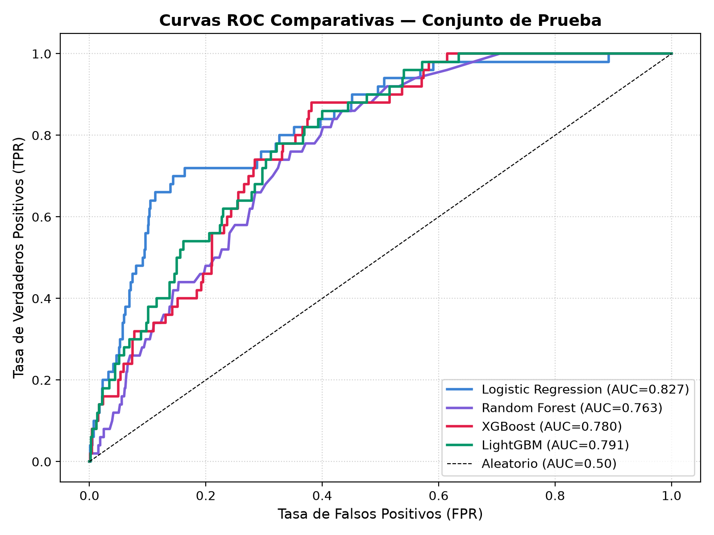
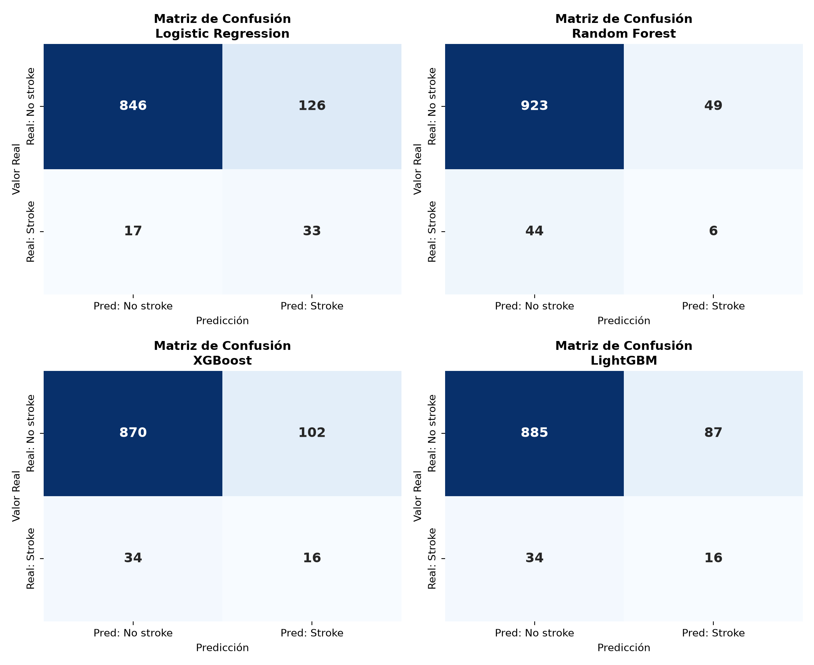
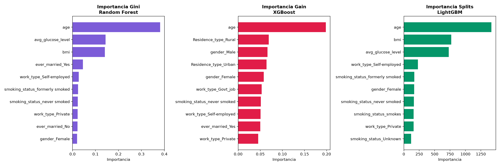

# Proyecto Minería de Datos — Predicción de Stroke

**UNAM · Facultad de Ingeniería · Minería de Datos · Grupo 1 · Semestre 2027-1**

Equipo:
- Rojas Chimal Karla Beatriz — 320048025
- García Gallegos Alejandro — 423093137

Profesor: Mtro. Gerardo Gabriel Carrasco Zúñiga

---

## Demo en línea

Prueba el modelo en **https://karlarochi.github.io/ProyectoMIneria/**: se capturan los datos de una persona y la página muestra la probabilidad de stroke estimada por la regresión logística y la clasificación con los umbrales 0.50 y 0.30. El cálculo se hace en el navegador con los coeficientes de `docs/model.json`, generados con `python export_web_model.py` después de ejecutar los notebooks 03 y 04.

---

## Objetivo

Desarrollar un modelo de **clasificación binaria supervisada** para predecir la probabilidad de
que un paciente sufra un evento cerebrovascular (*stroke*), utilizando el
[Stroke Prediction Dataset](https://www.kaggle.com/datasets/fedesoriano/stroke-prediction-dataset)
(5 110 registros, 12 variables).

Metodología de referencia: **CRISP-DM**.

---

## Estructura del repositorio

```
CODIGO/
├── data/                        # Dataset descargado (git-ignorado)
├── outputs/                     # Figuras y reportes generados
├── 01_data_loading.ipynb        # Fase 1 – Descarga y comprensión de datos
├── 02_eda.ipynb                 # Fase 2 – Análisis exploratorio de datos (EDA)
├── 03_preprocessing.ipynb       # Fase 3 – Preprocesamiento y limpieza
├── 04_modeling.ipynb            # Fase 4 – Entrenamiento y validación de modelos
├── 05_evaluation.ipynb          # Fase 5 – Evaluación, métricas y curvas ROC
├── export_web_model.py          # Exporta la regresión logística a docs/model.json
├── docs/                        # Página web (GitHub Pages) para probar el modelo
├── requirements.txt
└── README.md
```

---

## Instalación

```bash
pip install -r requirements.txt
```

> Se requiere una cuenta de Kaggle con `kaggle.json` configurado, **o** colocar el archivo
> `healthcare-dataset-stroke-data.csv` manualmente en la carpeta `data/`.

---

## Ejecución

Abre y ejecuta los notebooks en orden desde Jupyter:

```bash
jupyter notebook
```

> Usa el kernel del entorno del proyecto (`conda env create -f environment.yml` crea `mineria_stroke`).
> Ejecuta `03_preprocessing.ipynb` antes de `04_modeling.ipynb`: genera los conjuntos procesados que usa el modelado.

| Notebook | Fase CRISP-DM | Descripción |
|---|---|---|
| `01_data_loading.ipynb` | Fase 1 | Descarga del dataset, revisión de tipos, nulos y distribución de `stroke` |
| `02_eda.ipynb` | Fase 2 | Histogramas, boxplots, tasa por categoría, mapa de correlación |
| `03_preprocessing.ipynb` | Fase 3 | Imputación `bmi`, one-hot encoding, StandardScaler, SMOTE |
| `04_modeling.ipynb` | Fase 4 | Regresión Logística, Random Forest, XGBoost y LightGBM con StratifiedKFold (k=5); SMOTE dentro de cada fold |
| `05_evaluation.ipynb` | Fase 5 | AUC-ROC, Recall, F1, curvas ROC, matrices de confusión, importancia de variables |

---

## Métricas objetivo

| Métrica | Umbral esperado |
|---------|----------------|
| AUC-ROC | > 0.85 |
| Recall (clase positiva) | > 0.75 |
| F1-score | > 0.60 |

---

## Modelos evaluados

1. **Regresión Logística**: modelo base interpretable.
2. **Random Forest**
3. **XGBoost**
4. **LightGBM**

El desbalance de clases (~5 % de casos positivos) se trató con **SMOTE**, aplicado solo al entrenamiento (y dentro de cada fold durante la validación cruzada).

---

## Resultados (conjunto de prueba)

| Modelo | AUC-ROC |
|---|:---:|
| **Regresión Logística** | **0.827** |
| LightGBM | 0.791 |
| XGBoost | 0.780 |
| Random Forest | 0.763 |



El modelo más simple, la regresión logística, obtuvo el mejor AUC; los modelos de árboles no la superaron
con este conjunto de datos.

| Matrices de confusión | Importancia de variables |
|---|---|
|  |  |
